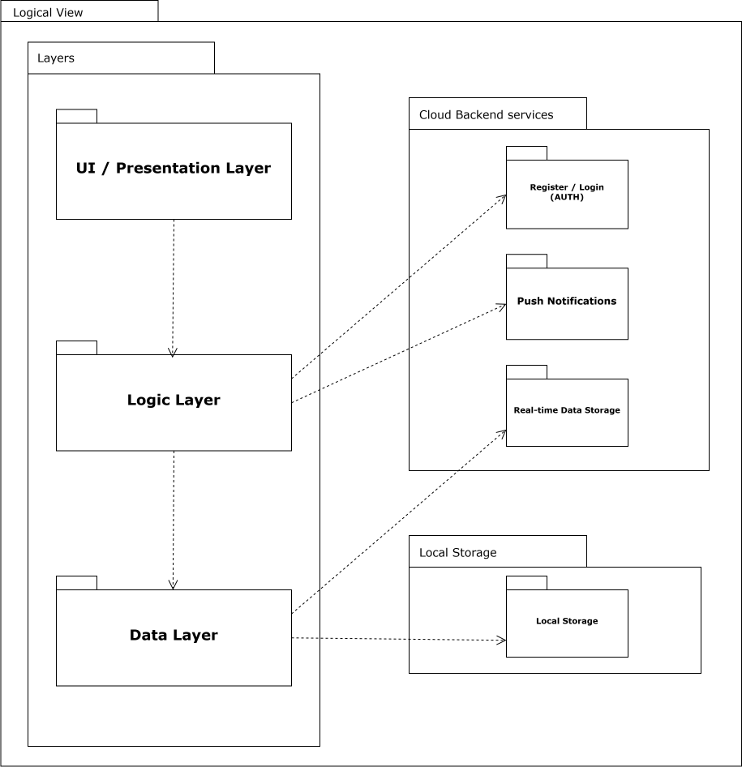
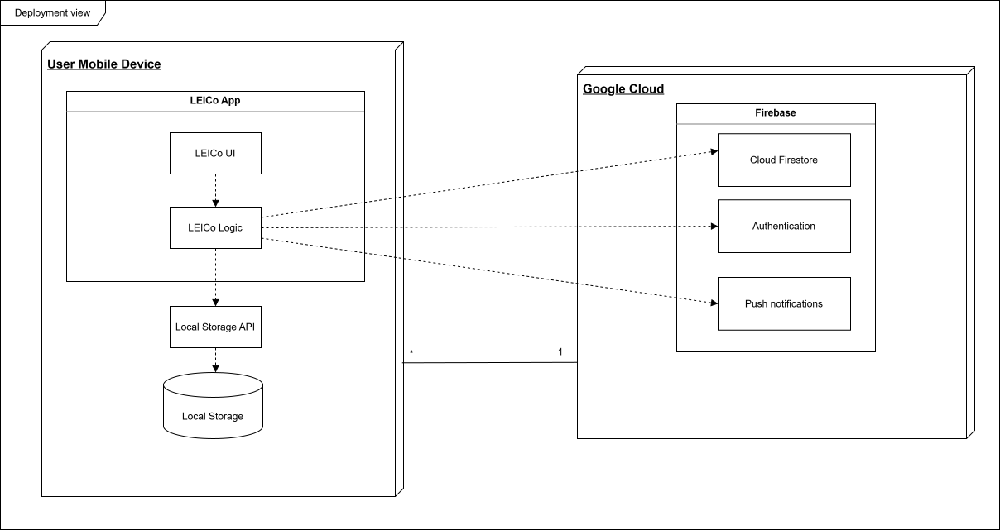

<!-- Template file for README.md for LEIC-ES-2025-26 -->

> [!NOTE] In this file, you will find the structure you should follow to document your mobile app in the README.md file for LEIC-ES-2025-26. It is a single file with guidelines, as comments, only seen in Edit mode, not in Preview mode. You can add more sections, but for assessment reasons and automation, please make sure to include all sections of this template. Your professors will clarify about specificities of your app.

# _[your product name]_ Development Report

Welcome to the documentation of _[your product name]_!

This Software Development Report, tailored for LEIC-ES-2025-26, provides comprehensive details about _[your product name]_, starting from an high-level vision and going into low-level implementation decisions. 

It is organised by the following activities: 

- [_\[your product name\]_ Development Report](#your-product-name-development-report)
  - [Business Modelling](#business-modelling)
    - [Product Vision](#product-vision)
    - [Features and Assumptions](#features-and-assumptions)
  - [Requirements](#requirements)
    - [User Stories](#user-stories)
    - [Domain model](#domain-model)
  - [Architecture and Design](#architecture-and-design)
    - [Logical architecture](#logical-architecture)
    - [Physical architecture](#physical-architecture)
    - [Functional prototype](#functional-prototype)
  - [Project management](#project-management)
    - [Sprint 0](#sprint-0)
    - [Sprint 1](#sprint-1)
    - [Sprint 2](#sprint-2)
    - [Sprint 3](#sprint-3)
    - [Sprint 4](#sprint-4)
    - [Final Release](#final-release)

Contributions are expected to be made exclusively by the initial team, but we may open them to the community, after the course, in all areas and topics: requirements, technologies, development, experimentation, testing, etc.

Please contact us!

Thank you!

* team member name and email
* team member name and email
* team member name and email
* team member name and email
* team member name and email

---
## Business Modelling

Business modeling in software development involves defining the product's vision, understanding market needs, aligning features with user expectations, and setting the groundwork for strategic planning and execution.

### Product Vision

This product is designed to help L.EIC students manage their collaborative projects. The app will allow students to create a collaborative workspace with curated templates desgined specifically for each project they will develop throughout the course, reducing the time spent on planning them.

<!-- 
Start by defining a clear and concise product vision for your app, to help members of the team, contributors, and users into focusing their often disparate views into a concise, visual, and short textual form. 

The vision should provide a "high concept" of the product for marketers, developers, and managers.

A product vision describes the essential of the product and sets the direction to where a product is headed, and what the product will deliver in the future. 

**We favor a catchy and concise statement, ideally one sentence.**

We suggest you use the product vision template described in the following link:
* [How To Create A Convincing Product Vision To Guide Your Team, by uxstudioteam.com](https://uxstudioteam.com/ux-blog/product-vision/)

To learn more about how to write a good product vision, please read:
* [Vision, by scrumbook.org](http://scrumbook.org/value-stream/vision.html)
* [Product Management: Product Vision, by ProductPlan](https://www.productplan.com/glossary/product-vision/)
* [20 Inspiring Vision Statement Examples (2019 Updated), by lifehack.org](https://www.lifehack.org/articles/work/20-sample-vision-statement-for-the-new-startup.html)
-->

### Features and Assumptions
<!-- 
Indicate an  initial/tentative list of high-level features - high-level capabilities or desired services of the system that are necessary to deliver benefits to the users.
 - Feature XPTO - a few words to briefly describe the feature
 - Feature ABCD - ...
...

Optionally, indicate an initial/tentative list of assumptions that you are doing about the app and dependencies of the app to other systems.
-->
- Create an account - each user of our app must be associated with a personal account, so they can access their projects, boards and tasks.
- Login authentication - to access their personal data, the user ust be able to log into the app.

- Custom template for each project - there will be a specifically-designed template, with predefined tasks, conceived to better address each project's needs.
- Create project board - a user can create his own project board from scratch if he does not want to use the custom template
- Add or edit custom columns - in any project board (template or not), the user may create new columns or edit existing ones to better fit his needs

- Predefined tasks - each template will have default tasks to guide the workflow of that project.
- Creating tasks - in addition to the already existing tasks, the user can add his own personalized tasks.
- Move tasks between columns (advanced) - the user may easily change the column of a task by dragging it to the desired column
- Hints/suggestions in templates - some costum templates will have suggestions that the user may choose or not to follow as he organises his board

- Invite members to project - the user can invite other users to join his collaborative project
- Join workspace via invite - an invited user must be able to accept the invitation to collaborate in a given project, so they can start contributing

- Assign tasks to users - when in a collaborative project, a user can assign a task to another team member
- Comment on tasks - a user can add a comment to a task, for example to provide useful information to the assigned person undertaking it
- Add a deadline - a user can add a deadline to a task so it becomes trackable
- Add labels to tasks - a user can add a label to a task to be able to filter them by label

- View personal tasks - a team member in a project can see all the tasks assigned to them clearly in a list, to better organize themselves
- View deadline-ordered tasks - a user can see all his personal tasks ordered by the upcoming deadlines
- View tasks ordered by labels - a user can choose to view the tasks ordered by labels

## Requirements

### User Stories
<!-- 
In this section you should describe all kinds of requirements for your module: functional and non-functional requirements.

For LEIC-ES-2025-26, the requirements will be gathered and documented as user stories. 

Please add in this section a concise summary of all the user stories (not each user story!).

**User stories as GitHub Project Items**
The user stories themselves should be created and described as items in your GitHub Project with the label "user story". 

A user story is a description of a desired functionality told from the perspective of the user or customer. A starting template for the description of a user story is *As a < user role >, I want < goal > so that < reason >.*

Name the item with either the full user story or a shorter name (recommended). In the “comments” field, add relevant notes, mockup images, and acceptance test scenarios, linking to the acceptance tests when available, and finally estimate value and effort.

**INVEST in good user stories**. 
You may add more details after, but the shorter and complete, the better. In order to decide if the user story is good, please follow the [INVEST guidelines](https://xp123.com/articles/invest-in-good-stories-and-smart-tasks/).

**User interface mockups**.
After the user story text, you should add a draft of the corresponding user interfaces, a simple mockup or draft, if applicable.

**Acceptance tests**.
For each user story you should write also the acceptance tests (textually in [Gherkin](https://cucumber.io/docs/gherkin/reference/)), i.e., a description of scenarios (situations) that will help to confirm that the system satisfies the requirements addressed by the user story.

**Value and effort**.
At the end, it is good to add a rough indication of the value of the user story to the customers (e.g. [MoSCoW](https://en.wikipedia.org/wiki/MoSCoW_method) method) and the team should add an estimation of the effort to implement it using points in a kind-of-a Fibonnacci scale (1,2,3,5,8,13,20,40, no idea).

-->

### Domain model

<!-- 
To better understand the context of the software system, it is useful to have a simple UML class diagram with all and only the key concepts (names, attributes) and relationships involved of the problem domain addressed by your app. 
Also provide a short textual description of each concept (domain class). 

Example:
 

  

-->

## Architecture and Design

### Overall architecture
The system follows a layered architecture, chosen to keep the code modular and easy to evolve while supporting real-time collaborative features.

- Presentation layer: React Native screens and reusable UI components (Login/Register, My Projects, Task Modal, Invites, Calendars, Profile).
- Application layer: use-case oriented services that coordinate user actions and business rules (create project, invite users, assign tasks, move task across columns, accept/decline invites, filter personal tasks, build global/project calendars).
- Data layer: map external data to the app's exsiting data model, used by the application layer,by abstracting cloud interactions.
- External services layer: cloud authentication, cloud database and push notifications used for login, data persistence and synchronization and real-time updates, respectively.

### Architectural Patterns
As described above, the high-level architecture is organized in layers with clear separation and modularity.

Regarding design patterns....

<!--
The architecture of a software system encompasses the set of key decisions about its organization. 

A well written architecture document is brief and reduces the amount of time it takes new programmers to a project to understand the code to feel able to make modifications and enhancements.

To document the architecture requires describing the decomposition of the system in their parts (high-level components) and the key behaviors and collaborations between them. 

In this section you should start by briefly describing the components of the project and their interrelations. You should describe how you solved typical problems you may have encountered, pointing to well-known architectural and design patterns, if applicable.
-->

### Logical architecture
<!--
The purpose of this subsection is to document the high-level logical structure of the code (Logical View), using a UML diagram with logical packages, without the worry of allocating to components, processes or machines.

It can be beneficial to present the system in a horizontal decomposition, defining layers and implementation concepts, such as the user interface, business logic and concepts.

Example of _UML package diagram_ showing a _logical view_ of the Eletronic Ticketing System (to be accompanied by a short description of each package):

-->
Logical modules are organized as follows.

#### In-app modules
- UI module: comprised by screens and UI components to easily interact with Authentication, My Projects, current Project Board, Task Detail/Creation Modal, My Tasks, Global Calendar, Project Calendar, Invites, Profile.

- Application module (use cases): used to fetch, manipulate and coordinate data inbetween layers, implementing the core functionality of the app, such as:
  - Auth: login, register, logout, session restore.
  - Project management: create project, load templates, create from template, invite member.
  - Task creation: create/edit task, assign member, move task between columns, comment, set deadlines and labels.
  - Calendar and Invites: list personal deadlines, list project deadlines, list pending invites, accept/decline invite.
  - Establishes rules and permissions between users inside a project.

- Data module
  - Defines data models for each entity of the app: User, Project, Board, Column, Task, Comment, Invite, Template.
  - Implements repositories that abstract the interaction with the cloud database, providing a clean API for the application module to fetch and manipulate data.
  - Access a local database to store user settings and offline data, if no connection is available.

#### External components
- Cloud auth service: identity management and secure session handling.
- Cloud database service: stores all data in a real-time cloud database, enabling multi-user synchronization and persistence.
- Push notification service: used to send real-time notifications to users about project updates, task assignments, and deadlines.

### Physical architecture

The physical architecture includes three main deployment nodes:

- Mobile device (Android/iOS)
  - Where the app will be installed and used by the students.

- Cloud backend 
  - Authentication service.
  - Real-time database service.
  - Responsibilities: account management, authorization checks, persistent storage, and multi-user synchronization.

- Data:
  - Cloud: source of truth for all data.
  - Device: cached session/profile and app data when offline.

<!--
The goal of this subsection is to document the high-level physical structure of the software system (machines, connections, software components installed, and their dependencies) using UML deployment diagrams (Deployment View) or component diagrams (Implementation View), separate or integrated, showing the physical structure of the system.

It should describe also the technologies considered and justify the selections made. Examples of technologies relevant for ESOF are, for example, frameworks for mobile applications (such as Flutter).

Example of _UML deployment diagram_ showing a _deployment view_ of the Eletronic Ticketing System (please notice that, instead of software components, one should represent their physical/executable manifestations for deployment, called artifacts in UML; the diagram should be accompanied by a short description of each node and artifact):

-->

### Functional prototype
<!--
To help on validating all the architectural, design and technological decisions made, we usually implement a functional prototype, a thin vertical slice of the system integrating as much technologies as we can.

In this subsection please describe which feature, or part of it, you have implemented, and how, together with a snapshot of the user interface, if applicable.

At this phase, instead of a complete user story, you can simply implement a small part of a feature that demonstrates thay you can use the technology, for example, show a screen with the app credits (name and authors).
-->

## Project management
<!--
Software project management is the art and science of planning and leading software projects, in which they are planned, implemented, monitored and controlled.

In the context of ESOF, we recommend each team to adopt a set of project management practices and tools capable of registering tasks, assigning tasks to team members, adding estimations to tasks, monitor tasks progress, and therefore being able to track their projects.

Common practices of managing agile software development with Scrum are: backlog management, release management, estimation, Sprint planning, Sprint development, acceptance tests, and Sprint retrospectives.

You can find below information and references related with the project management: 

* Backlog management: Product backlog and Sprint backlog in a [Github Projects board](https://github.com/orgs/FEUP-LEIC-ES-2023-24/projects/64);
* Release management: [v0](#), v1, v2, v3, ...;
* Sprint planning and retrospectives: 
  * plans: screenshots of Github Projects board at begin and end of each Sprint;
  * retrospectives: meeting notes in a document in the repository, addressing the following questions:
    * Did well: things we did well and should continue;
    * Do differently: things we should do differently and how;
    * Puzzles: things we don’t know yet if they are right or wrong;
    * list of a few improvements to implement next Sprint;

-->

### Sprint 0

### Sprint 1

### Sprint 2

### Sprint 3

### Sprint 4

### Final Release

